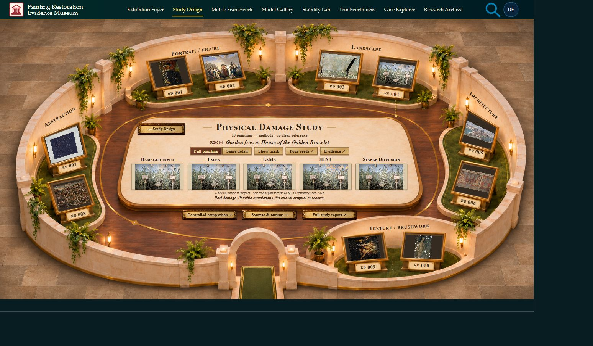

# Physical Damage Study — Implementation and Validation

**Current status:** deployed on the main museum since 17 November 2026, after
validation on a separate test deployment. The existing public URL and eight
principal rooms are unchanged. The original feature branch and test app remain
available; no merge or deployment step is pending.

## Delivered behaviour

- `?room=physical_damage_study` opens the approved single overhead hall at
  `rd004`. Ten framed selectors update the central inspection table in place.
- The table contains the damaged input and the exact four primary D04 outputs.
  SD uses the recorded primary seed 2026, not a visually selected alternative.
- Full painting removes preprocessing padding only. Same detail uses the
  recorded D04 largest-component display crop, consistently across all five
  images. It is explicitly separate from metric-region definitions.
- Mask overlay, enlarged-image dialog and model switching preserve the case
  and view state. No image is stretched to fill a scientific comparison panel.
- In-room evidence dialogs expose the approved observations, boundary/edit
  descriptors, outside-mask checks, all four SD seeds and saved variability
  evidence, controlled comparisons, sources, targeted prompts and settings.
- The complete saved D04 HTML report loads only when requested and is available
  for download. It remains sandboxed in the report dialog.
- Study Design's right-hand alcove contains both Portrait audit and Physical
  damage. The portrait route is preserved. The eight principal navigation
  tabs, core population counts and tour numbering remain unchanged.
- Narrow screens use readable selectors, comparison cards and the same
  evidence dialogs. Navigation remains available through its scrollable row.

## Evidence and implementation boundaries

`src/restoration_eval/physical_damage.py` reads the completed D03/D04 records.
D04 individual artifacts are SHA-256/size verified against its manifest. D03
image-collection members are checked against the SHA-256 values in its
manifest-verified preprocessing and mask tables. Source/candidate and
observation identities are cross-checked before display. Missing or mismatched
evidence fails closed rather than substituting another record.

Scientific images and records remain unchanged. The generated room shell is
decoration only: its blank frames receive the real recorded images. Original
aspect ratios are retained; rotated perimeter previews are only selectors.
No inference, notebook execution, metric recomputation or expert assessment
was performed. Physical cases have no clean reference. Controlled examples
are distinct artworks and retain their own reference metrics. The prompt
difference between targeted physical SD and the saved controlled configurations
is disclosed alongside comparisons.

The separate `config/publication/physical_damage_room_delta.json` records exact
before/after identities for the approved route, alcove and related regression
assertions. The baseline adapter unwinds only those exact changes before
checking the existing freeze. Original N34/N35/N36 freeze and producer records
were not rewritten to make the extension pass.

## Verification

- **68 Python tests passed**: physical-room data/provenance and lazy report
  access, room navigation, existing dashboard application and portrait room.
- **4 Node navigation/readiness tests passed**; new controller syntax checked.
- Browser: every selector `rd001`–`rd010` updated its exact case title and table;
  all five images loaded, and the opening case was restored to `rd004`.
- Browser: full/detail switching, visible mask overlay and enlarged SD inspection;
  four saved seeds, observations/diagnostics, controlled
  comparison and source/settings panels; saved complete report content loaded.
- Browser: both Study Design supplementary tiles opened the intended room;
  return navigation preserved the existing Study Design content and counts.
- Browser: narrow viewport, no document horizontal overflow, readable evidence
  dialog, Escape closing, and restoration of the normal desktop viewport.

```powershell
$env:PYTHONPATH = 'src'
.\.venv\Scripts\python.exe -m pytest tests/test_physical_damage.py tests/test_room_runtime.py tests/test_dashboard_application.py tests/test_focused_portrait.py -q --tb=line
node --check streamlit_assets/physical_damage_controller.js
node --test tests/room_runtime.test.cjs
```

## Deployment repair and final checks

The first test deployment exposed root-relative `/media/...` links that did not
resolve inside Community Cloud's `/~/+/` base path. App-relative `media/...`
links now resolve against the host document. Readiness requires decoded images
and painted canvases; startup failure leaves an explicit reload message instead
of apparently active controls.

The local checks included ordinary and `/museum/` base-path servers. The final
review covered all ten selectors, full/detail views, masks, enlargement, seed
panels, evidence, controlled comparisons, source/settings and the complete report.
The final pre-commit selection had 93 passes and one stale alcove assertion;
after that assertion was corrected, all 37 dashboard/freeze checks passed.
All 133 distinct producer files read by the room matched their Git source bytes.
Four room-runtime Node tests and controller syntax checks passed.

The repaired test app was validated before merge. Main now runs the same
physical-room readiness checks in addition to the existing Foyer and Case
Explorer checks. A successful check covers those interactions at that time; it
does not establish an independent expert assessment or an uptime guarantee.

## Monitoring

Cloudflare dispatches the availability workflow on `main`. Monitoring continues
until the schedule is disabled; there is no automatic 38- or 48-hour expiry.
The separate historical test branch retains its own deployment checker. See the
[current scheduler guide](../../tools/streamlit_scheduler/README.md) for token
rotation, dispatch and schedule maintenance. Pushing to GitHub does not deploy
Worker settings or rotate its secret.

## Final appearance




The saved screenshots document the local approved appearance. Main and the test
app use the same design, while cloud availability remains subject to monitoring.
