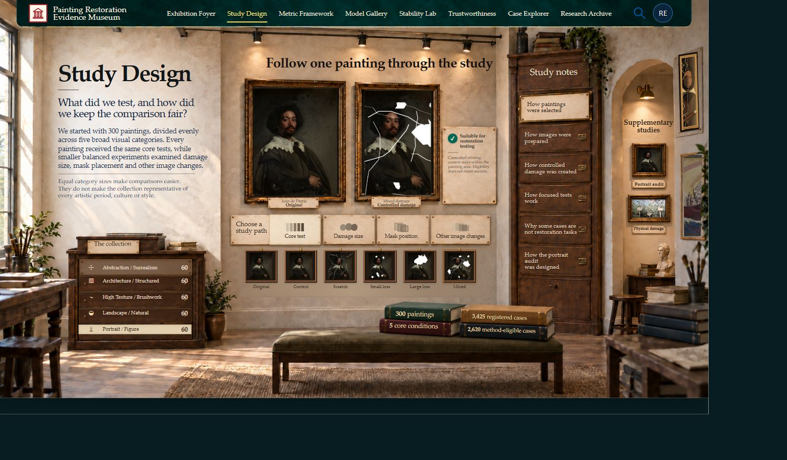

# Physical Damage Study — local implementation and validation

Date: 2026-11-16. Branch: `codex/physical-damage-room`.
Approved visual authority: [design contract](physical_damage_study_design.md).
Status: final local appearance accepted by the author on 2026-11-16; no commit,
push, cloud deployment or merge performed in this implementation pass.

## Delivered behaviour

- `?room=physical_damage_study` opens the approved single overhead hall at
  `rd004`. Ten framed selectors update the central inspection table in place.
- The table contains the damaged input and the exact four primary D04 outputs.
  SD uses the recorded primary seed 2026, not a visually selected alternative.
- Full painting removes preprocessing padding only. Same detail uses the
  recorded D04 largest-component display crop, consistently across all five
  images. It is explicitly separate from metric-region definitions.
- Mask overlay, enlarged-image dialog and model switching preserve the case
  and view state. No image is stretched to fill a scientific comparison panel.
- In-room evidence dialogs expose the approved observations, boundary/edit
  descriptors, outside-mask checks, all four SD seeds and saved variability
  evidence, controlled comparisons, sources, targeted prompts and settings.
- The complete saved D04 HTML report loads only when requested and is available
  for download. It remains sandboxed in the report dialog.
- Study Design's right-hand alcove contains both Portrait audit and Physical
  damage. The portrait route is preserved. The eight principal navigation
  tabs, core population counts and tour numbering remain unchanged.
- Narrow screens use readable selectors, comparison cards and the same
  evidence dialogs. Navigation remains available through its scrollable row.

## Evidence and implementation boundaries

`src/restoration_eval/physical_damage.py` reads the completed D03/D04 records.
D04 individual artifacts are SHA-256/size verified against its manifest. D03
image-collection members are checked against the SHA-256 values in its
manifest-verified preprocessing and mask tables. Source/candidate and
observation identities are cross-checked before display. Missing or mismatched
evidence fails closed rather than substituting another record.

Scientific images and records remain unchanged. The generated room shell is
decoration only: its blank frames receive the real recorded images. Original
aspect ratios are retained; rotated perimeter previews are only selectors.
No inference, notebook execution, metric recomputation or expert assessment
was performed. Physical cases have no clean reference. Controlled examples
are distinct artworks and retain their own reference metrics. The prompt
difference between targeted physical SD and the saved controlled configurations
is disclosed alongside comparisons.

The separate `config/publication/physical_damage_room_delta.json` records exact
before/after identities for the approved route, alcove and related regression
assertions. The baseline adapter unwinds only those exact changes before
checking the existing freeze. Original N34/N35/N36 freeze and producer records
were not rewritten to make the extension pass.

## Verification

- **68 Python tests passed**: physical-room data/provenance and lazy report
  access, room navigation, existing dashboard application and portrait room.
- **4 Node navigation/readiness tests passed**; new controller syntax checked.
- Browser: every selector `rd001`–`rd010` updated its exact case title and table;
  all five images loaded, and the opening case was restored to `rd004`.
- Browser: full/detail switching, visible mask overlay and enlarged SD inspection;
  four saved seeds, observations/diagnostics, controlled
  comparison and source/settings panels; saved complete report content loaded.
- Browser: both Study Design supplementary tiles opened the intended room;
  return navigation preserved the existing Study Design content and counts.
- Browser: narrow viewport, no document horizontal overflow, readable evidence
  dialog, Escape closing, and restoration of the normal desktop viewport.

```powershell
$env:PYTHONPATH = 'src'
.\.venv\Scripts\python.exe -m pytest tests/test_physical_damage.py tests/test_room_runtime.py tests/test_dashboard_application.py tests/test_focused_portrait.py -q --tb=line
node --check streamlit_assets/physical_damage_controller.js
node --test tests/room_runtime.test.cjs
```

## Alcove refinement following local review

The flat supplementary-entry panel was replaced by wall lettering and two
gilded frames integrated with the textured alcove. Only the entrance markup,
its stylesheet and its decorative asset changed; the physical-study room and
scientific evidence were not modified in this refinement.

- **29 dashboard application tests passed** after the entrance change.
- Browser: both links opened their intended rooms and returned to Study Design.
- Browser: confirmed transparent entrance background and aligned frame images
  and plaques on desktop. Follow-up review removed both count lines, centered
  the two-line heading slightly farther left and fitted Physical damage inside
  its plaque; both destination links remain intact.
- Browser: narrow-screen entries align side by side, with 17px titles and no
  document horizontal overflow. Desktop viewport restored.
- The original Study Design shell remains unchanged. This is still an
  uncommitted local preview, pending the author's inspection.

## Physical-room refinement following annotated review

- Main heading, selected title, controls, interpretation note and evidence
  links now fit on the central stone table. Wall labels use smaller brown
  serif lettering and revised placement; no text crosses the doorway.
- Ten selector previews use the measured inner frame corners, retaining
  complete painting content within a dark mat. Projection is limited to
  decorative selectors, with an ordinary rectangular mobile fallback.
- Browser: all ten selectors updated the correct title and five comparison
  images. The longest title fitted without wrapping onto the controls, and
  the interpretation note remained within the tabletop for every case.
- Browser: detail view, mask toggle, enlarged SD inspection and the relocated
  source/settings link worked. The default whole-painting view was restored.
- Browser: exactly one museum navigation bar. Narrow viewport had no document
  horizontal overflow, and all selectors returned to rectangular display.
- **24 physical-room tests passed**; JavaScript syntax check passed.

Follow-up typography/plaque review:

- Compared the live Research Archive and Study Design treatments. Darkened
  category lettering to `#342012` at weight 700, introduced bold catalogue
  numbers, small-cap headings, italic artwork titles and brass control details.
- Added a reusable transparent walnut/brass plaque asset for the return link
  and three evidence links. These are live links, not text baked into imagery.
- Browser: all ten catalogue labels fitted their plaques; the longest artwork
  title stayed clear of controls. The source/settings plaque opened the correct
  selected-case panel. Mobile links retained 44px targets without horizontal
  overflow, and all ten preview images rendered after viewport repaint.
- The existing selector/route regression test passed after the markup change.

Final backdrop/plaque follow-up:

- Replaced the exterior blueprint texture with warm stone flooring; visually
  checked the ten projected frame previews against the edited shell.
- Centered the three evidence plaques beneath the table. Browser measurements
  found less than 0.01 CSS pixel difference between their horizontal centers.
- Narrow-screen check: no horizontal document overflow; the wrapping plaque
  group uses no translation and retains approximately 44px link heights.
- Python compilation passed for the changed room view. Existing scientific
  artifacts and inference settings were not changed.

## Final pre-commit checks — 2026-11-16

The author accepted the final appearance, including the Architecture wall label.
The final Python selection covered 94 checks: 93 passed initially, and the one
stale alcove assertion was corrected to the approved caption-only design.
The 37 dashboard/freeze checks then all passed, including that assertion.
The original freeze preimages remain unchanged; the supplementary receipt
records the revised regression-test fingerprint.

```powershell
$env:PYTHONPATH = 'src;tests;tools'
.\.venv\Scripts\python.exe -m pytest tests/test_physical_damage.py tests/test_room_runtime.py tests/test_dashboard_application.py tests/test_focused_portrait.py tests/test_real_damage_publication.py tests/test_publication_freeze_delta.py tests/test_finished_tab_publication.py -q --tb=short
```

The publication test imports a shared test fixture, so this selection requires
the `tests` directory on `PYTHONPATH`. JavaScript syntax checking and all four
room-runtime Node tests passed.

All ten cases and six panel states were traversed with producer checksum
validation. All 133 distinct producer files read by the room match exact Git
HEAD blob contents, not just locally present files. New decorative assets use
ordinary Git, with no Git LFS upload required for this extension. The full
inventory CSV retains its existing ignored status; its run manifest is tracked.

Separate deployment uses repository `Rahul-DS25M008/painting_restoration_eval`,
branch `codex/physical-damage-room`, entrypoint `streamlit_app.py` and Python
3.12. No new secrets or inference dependencies are required by this room.
The existing main-app availability workflow does not validate the new test URL.
Before merging, verify the new cloud app's two Study Design entries, ten case
selectors, full/detail and mask controls, enlarged images, four seeds, evidence,
comparison, sources and complete report, plus the existing principal navigation.
Cloud loading, remote evidence and server logs must be checked on that deployment;
local success alone does not certify Community Cloud behaviour.

## Test deployment repair and monitoring — 2026-11-17

The first cloud deployment exposed an application URL bug. New media used
root-relative `/media/...` paths, whereas the public Community Cloud app runs
inside `/~/+/`. The new Study Design alcove and physical tile could not decode;
the physical room lost its decorative assets and comparison images. The
controller stopped before attaching controls when those images failed. This
was not evidence that the committed producer files were missing. Opening the
same cloud alcove image at `/~/+/media/...` decoded the full 1672px image.

`physical_damage.app_media_url` now emits app-relative `media/...` paths for
both verified producer artifacts and decorative assets. The controller resolves
images against the host document's base URI, verifies background/plaque loading,
marks canvases only after painting and displays an explicit reload message with
disabled controls on startup failure. The approved layout is unchanged.

Manual browser checks passed on the ordinary localhost app and a second
localhost server configured with the `/museum/` base path. The latter loaded
all three Study Design images, the room/plaque, ten selectors and five primary
images; full/detail, mask, case selection and enlargement worked. Saved seed
images/figure, physical/controlled comparison figures, source settings and the
complete report were also opened. These are local checks, not a cloud pass.

The availability workflow now maps `codex/physical-damage-room` exclusively to
the physical-test deployment, retaining main's original target and separating
concurrency by ref. Its additional smoke checks cover the alcove, painted
canvases, decorations, interactive detail/mask/enlargement, case navigation,
seeds and sources. Main's fallback behaviour is retained; neither test route
can substitute the main app. CI browser fixtures cover missing alcove/background
and unpainted images, alongside the original readiness tests.

Cloudflare setup and the 48-hour observation gate are documented in
[`tools/streamlit_scheduler/README.md`](../../tools/streamlit_scheduler/README.md).
The new Worker defaults to main unless `GITHUB_REF` is explicitly set to the
approved test branch. Its other ref values are rejected before dispatch.
No Worker was deployed or cron enabled by this code change. No merge to main
is authorized by a passing local test or by successful dispatch alone.

Browser screenshots (updated after the annotated refinements):




Local review URLs:

- <http://127.0.0.1:8501/?room=physical_damage_study>
- <http://127.0.0.1:8501/?room=study_design>

These checks establish local behaviour only. After author acceptance, the
separate branch deployment still needs its own clean-environment source-asset,
performance and browser verification before merge into the main app.
